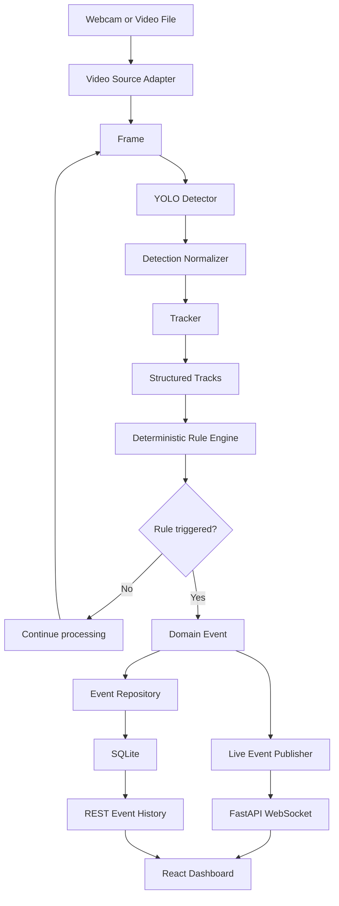

# System Architecture

## 1. Architecture principles
1. Start as a modular monolith on one machine.
2. Keep computer vision independent from HTTP request handling.
3. Pass structured data between modules rather than passing framework-specific objects everywhere.
4. Keep event rules deterministic and testable.
5. Use asynchronous messaging only where it provides clear value.
6. Measure before optimizing.
7. Treat local-first operation as the baseline; cloud and edge deployment are later options.

## 2. Logical components

### A. Video source adapter
Responsibilities:
- Open webcam, local file, or later an authorized RTSP stream.
- Read frames and attach source ID and frame timestamp.
- Report open/read failures.
- Release resources reliably.

Does not:
- Run business rules.
- Send push notifications.
- Write directly to the frontend.

### B. Vision pipeline
Responsibilities:
- Preprocess frames as required by the model.
- Run object detection.
- Apply confidence and class filters.
- Normalize model output into the application's detection schema.
- Optionally render an annotated frame for local preview.

### C. Tracker adapter
Responsibilities:
- Associate detections across frames.
- Return track IDs and track state where supported.
- Handle tracker reset when a source restarts.

Important: a track ID is generally scoped to a tracker session/source and may change after restart. Do not treat it as a permanent identity.

### D. Event/rule engine
Responsibilities:
- Evaluate deterministic conditions such as restricted-zone entry.
- Maintain per-track rule state.
- Apply debounce/cooldown rules.
- Emit domain events.
- Remain independent of FastAPI and database libraries.

### E. Event repository
Responsibilities:
- Save and query event records.
- Own database interaction and migrations/schema setup.
- Convert persistence errors into visible application errors/logs.

### F. Application service
Responsibilities:
- Orchestrate the vision pipeline and event engine.
- Publish newly created events to subscribers.
- Expose current service/source status.
- Keep long-running video processing separate from API request lifecycle.

### G. FastAPI API
Responsibilities:
- Health/status endpoint.
- Event history endpoint.
- WebSocket endpoint for live events.
- Input validation, response schemas, and API error handling.

### H. Frontend
Responsibilities:
- Display system/source status.
- Display detections or annotated video.
- Subscribe to live events.
- Fetch historical events.
- Show loading, empty, disconnected, and error states.

## 3. Data flow


## 4. Recommended local deployment
- One Python process owns video capture and inference.
- FastAPI serves status, history, and WebSockets.
- SQLite stores event history.
- React runs as a separate development server.
- The vision pipeline communicates with the application service through an in-process queue or callback initially.
- Use bounded queues if producer and consumer rates can differ; define whether to drop old frames or apply backpressure.

Avoid doing expensive model inference directly inside an HTTP request handler.

## 5. Suggested source layout
```text
backend/
  app/
    main.py
    api/
      routes_health.py
      routes_events.py
      routes_stream.py
    schemas/
      event.py
      status.py
    services/
      event_service.py
      event_publisher.py
    repositories/
      event_repository.py
    config.py
vision/
  source.py
  detector.py
  tracker.py
  pipeline.py
  schemas.py
rules/
  geometry.py
  restricted_zone.py
frontend/
  src/
    components/
    pages/
    hooks/
    api/
tests/
  unit/
  integration/
  fixtures/
docs/
```

This is a target structure, not a requirement to create all files on day one.

## 6. Key architectural decisions
- **Detection vs. tracking:** detector outputs per-frame observations; tracker associates observations into trajectories.
- **Rules vs. AI:** business rules such as zone intrusion should be deterministic and independently testable.
- **Events vs. frames:** transmit events and compact metadata to clients first; streaming every frame through the API is a separate design decision.
- **Storage:** store event metadata first. Add image/video storage only when needed.
- **Cloud:** do not introduce cloud dependencies until local behavior and contracts are stable.
- **Multiple cameras:** introduce per-source pipeline state and resource limits only after single-source correctness.

## 7. Failure handling
| Failure | Expected behavior |
|---|---|
| Video source cannot open | Report source status as failed and log reason |
| Frame read fails | Stop or reconnect according to source type; release resources |
| Model cannot load | Fail startup clearly; do not pretend detections are working |
| Tracker returns no ID | Continue with detection; rules that require track ID should skip or use a documented fallback |
| Database write fails | Log error and surface degraded status; do not silently claim persistence succeeded |
| WebSocket disconnects | Client reconnects with bounded retry/backoff |
| Frontend API unavailable | Show disconnected state and retry |
| Malformed configuration | Validate at startup and provide actionable error |

## 8. Scaling path
1. Single video + single process.
2. Single video + backend and dashboard.
3. Multiple sources with per-source state and bounded queues.
4. Separate inference workers if profiling justifies it.
5. Edge devices send events/metadata to a central backend.
6. Cloud storage, device management, authentication, metrics and deployment automation.
