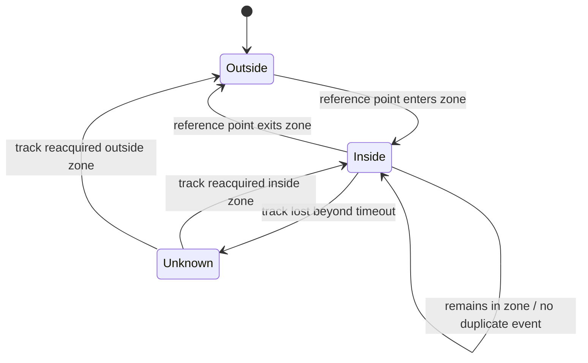

# Workflow and Data Contracts

## 1. Runtime workflow
1. Load configuration and model.
2. Initialize event repository and rule engine.
3. Open the configured video source.
4. Read a frame and capture a timestamp.
5. Run detector inference.
6. Normalize detections to application-owned data structures.
7. Update tracker state.
8. Evaluate rules for each valid track.
9. Create a domain event only on a documented state transition.
10. Persist event metadata.
11. Publish event to connected subscribers.
12. Continue until stop signal, end-of-file, or unrecoverable error.
13. Release camera, model, database, and network resources cleanly.

## 2. Detection contract
Illustrative Python-style schema:
```python
Detection = {
    "class_id": int,
    "class_name": str,
    "confidence": float,  # 0.0 through 1.0
    "bbox": {
        "x1": float,
        "y1": float,
        "x2": float,
        "y2": float
    }
}
```
Coordinate convention: pixel coordinates relative to the original frame, with `x1 <= x2` and `y1 <= y2`. Document whether coordinates are integer or floating point at each boundary.

## 3. Track contract
```python
Track = {
    "track_id": int | str | None,
    "class_name": str,
    "confidence": float,
    "bbox": {
        "x1": float,
        "y1": float,
        "x2": float,
        "y2": float
    },
    "frame_timestamp": str
}
```
Track IDs may be absent, temporary, reused after a tracker reset, or incorrect after an association error. Scope track IDs to a source and tracker session.

## 4. Event contract
Example JSON:
```json
{
  "event_id": "evt_01JEXAMPLE",
  "camera_id": "local_camera_01",
  "event_type": "restricted_zone_intrusion",
  "occurred_at": "2026-10-09T17:12:15.120Z",
  "object_class": "person",
  "track_id": "7",
  "confidence": 0.94,
  "zone_id": "restricted_zone_A",
  "bbox": {
    "x1": 120,
    "y1": 80,
    "x2": 260,
    "y2": 430
  },
  "snapshot_path": null
}
```
Values are illustrative. Use UTC timestamps with timezone information in stored API data. Convert to local time only in the UI.

### Required fields
- `event_id`: unique event identifier.
- `camera_id`: stable identifier for the configured source.
- `event_type`: machine-readable event name.
- `occurred_at`: timestamp with timezone.
- `object_class`: class name that triggered the event.
- `track_id`: optional track identifier.
- `confidence`: optional or required by event policy; define consistently.
- `zone_id`: required for zone events.
- `bbox`: optional event-time bounding box.
- `snapshot_path`: optional pointer to an authorized local/object-storage asset.

## 5. Restricted-zone rule
Recommended initial policy:
- Zone is a polygon in frame pixel coordinates or normalized coordinates.
- The reference point is the bottom-center of the object's bounding box, approximating ground contact for a standing person.
- An event triggers when a tracked person transitions from outside to inside.
- The rule stores that the track is currently inside.
- Do not create one event per frame.
- If the track exits and later re-enters, a new event may be generated.
- If a track disappears while inside, expire state after a configured timeout.
- Document behavior when the camera resolution changes.

Normalized coordinates in the range 0..1 are preferable for configuration portability across resolutions, but require consistent coordinate conversion.

## 6. State transitions


Choose and document whether `Unknown -> Inside` generates a new alert. A conservative first version may emit an event only on a clearly observed outside-to-inside transition.

## 7. Event publishing behavior
- Persist the event before publishing it, or explicitly document a different consistency strategy.
- WebSocket payload should use the same event schema as REST history where possible.
- If clients are disconnected, persisted events remain available from history.
- Initial MVP does not guarantee delivery to every client or exactly-once delivery. Clients should tolerate reconnects and duplicate messages.
- Include event IDs so clients can deduplicate.

## 8. Time and identity
- Store UTC timestamps in ISO 8601 format.
- Include timezone information; avoid ambiguous local timestamps.
- A camera/source ID is application configuration, not necessarily a hardware serial number.
- A track ID is not a person's identity and must not be used as a permanent user identifier.
